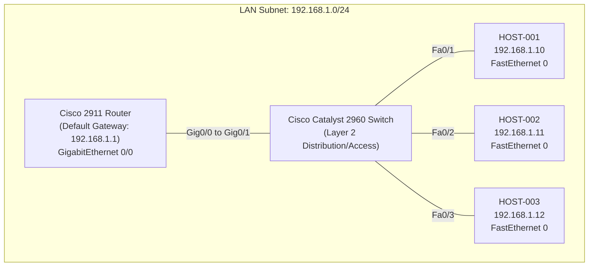

# Network Topology Explanation
**Project Name:** Network Bandwidth Usage Anomaly Detection System  
**Document Purpose:** Network Architecture and Topology Specification for Academic Submission  

---

## 1. Overview and Project Context

The **Network Bandwidth Usage Anomaly Detection System** is designed to monitor, analyze, and detect irregularities in data transmission rates across networked end devices. To test, validate, and demonstrate this system in a controlled environment, a standardized local area network (LAN) topology was established.

This setup models a corporate or institutional branch network consisting of three active workstation hosts, a central enterprise access switch, and an edge router serving as the default gateway.

---

## 2. Topology Classification

### Physical Topology: Star Topology
All client workstations (`HOST-001`, `HOST-002`, `HOST-003`) and the router are physically connected via dedicated unshielded twisted pair (UTP) copper Ethernet cables to a central Cisco Catalyst 2960 switch. 

**Advantages of Star Topology for this Project:**
- **Centralized Traffic Monitoring:** All host-to-host and host-to-gateway traffic traverses the central switch, providing a single vantage point for traffic capture and bandwidth monitoring.
- **Fault Isolation:** If an individual link or workstation fails, other network nodes remain fully operational without service disruption.
- **Ease of Troubleshooting:** Port-level statistics and activity LEDs on the switch simplify the process of diagnosing link issues and localized traffic surges.

### Logical Topology: Star / Broadcast Network
Logically, all end devices share a common IP subnet (`192.168.1.0/24`). Frame forwarding within the subnet operates at Layer 2 based on Media Access Control (MAC) addresses, while inter-network communications or exterior routing are directed to the default gateway at Layer 3.

---

## 3. Network Architecture Diagram

### Logical Diagram (Mermaid)



### Visual Topology Layout (ASCII Art)

```
                       +-----------------------------+
                       |      Cisco 2911 Router      |
                       |       (Default Gateway)     |
                       |         192.168.1.1         |
                       +--------------+--------------+
                                      | [Gig 0/0]
                                      |
                                      | Cat6 UTP Cable
                                      |
                                      | [Gig 0/1]
                       +--------------+--------------+
                       |   Cisco 2960 24-Port Switch |
                       |      (Layer 2 Central)      |
                       +----+---------+---------+----+
                            |         |         |
              [Fa 0/1]      |         | [Fa 0/2]|      [Fa 0/3]
       +--------------------+         |         +--------------------+
       |                              |                              |
       | Cat5e/6 UTP                  | Cat5e/6 UTP                  | Cat5e/6 UTP
       |                              |                              |
+------+------+                +------+------+                +------+------+
|  HOST-001   |                |  HOST-002   |                |  HOST-003   |
| 192.168.1.10|                | 192.168.1.11|                | 192.168.1.12|
+-------------+                +-------------+                +-------------+
```

---

## 4. Hardware and Infrastructure Components

| Device Identifier | Hardware Model | Primary Function | Configured IP | Connected Interface |
| :--- | :--- | :--- | :--- | :--- |
| **Router** | Cisco 2911 ISR | Layer 3 Default Gateway, Routing, Border Forwarding | `192.168.1.1` | GigabitEthernet 0/0 |
| **Switch** | Cisco Catalyst 2960-24TT | Layer 2 Switching, Local Frame Forwarding, MAC Table Management | Managed / Unassigned in Data Plane | Uplink: Gig0/1, Access: Fa0/1–Fa0/3 |
| **HOST-001** | Workstation PC | Traffic Generation / Client Node | `192.168.1.10` | FastEthernet 0 |
| **HOST-002** | Workstation PC | Traffic Generation / Client Node | `192.168.1.11` | FastEthernet 0 |
| **HOST-003** | Workstation PC | Traffic Generation / Client Node | `192.168.1.12` | FastEthernet 0 |

---

## 5. Port Allocation and Cabling Specifications

1. **Uplink Connection (Router to Switch):**
   - **Endpoints:** Cisco 2911 (`GigabitEthernet 0/0`) <--> Cisco 2960 (`GigabitEthernet 0/1`)
   - **Cable Type:** Straight-Through Twisted Pair (Category 6)
   - **Bandwidth Capability:** 1000 Mbps (1 Gbps) full-duplex

2. **Access Port Connections (Hosts to Switch):**
   - **Port FastEthernet 0/1:** Connects to `HOST-001` Network Interface Card (`FastEthernet 0`)
   - **Port FastEthernet 0/2:** Connects to `HOST-002` Network Interface Card (`FastEthernet 0`)
   - **Port FastEthernet 0/3:** Connects to `HOST-003` Network Interface Card (`FastEthernet 0`)
   - **Cable Type:** Straight-Through Twisted Pair (Category 5e / Category 6)
   - **Bandwidth Capability:** 100 Mbps full-duplex per host port

---

## 6. Packet Flow and Operational Mechanics

### A. Intra-Subnet Communication (e.g., HOST-001 to HOST-002)
1. **Address Resolution:** `HOST-001` determines that destination IP `192.168.1.11` belongs to its local subnet (`192.168.1.0/24`).
2. If the MAC address of `HOST-002` is not cached in `HOST-001`'s ARP table, `HOST-001` broadcasts an ARP Request frame.
3. The Cisco 2960 switch floods the broadcast frame out of all active access ports within the VLAN/broadcast domain.
4. `HOST-002` replies with a unicast ARP Reply carrying its MAC address.
5. The switch records the MAC addresses and their corresponding ingress ports in its MAC Address Table.
6. Subsequent IP packets travel strictly between port `Fa0/1` and port `Fa0/2` without burdening the router or other endpoints.

### B. Outbound Communication (Host to Default Gateway)
1. When any workstation transmits packets destined outside the local subnet, it encapsulates the IP payload with the destination MAC address of the default gateway (`192.168.1.1` on interface `Gig0/0`).
2. The switch receives the frame on the respective access port (`Fa0/1`, `Fa0/2`, or `Fa0/3`) and forwards it across the high-speed uplink `Gig0/1` directly to router interface `Gig0/0`.
3. The Cisco 2911 router inspects the Layer 3 header, consults its internal routing table, and determines next-hop forwarding.

---

## 7. Role in the Anomaly Detection System

In this project, the physical and logical topology provides the testing bed for detecting bandwidth anomalies:

- **Baseline Traffic Profile:** Under standard operational conditions, traffic between `HOST-001`, `HOST-002`, and `HOST-003` consists of normal administrative queries, scheduled transfers, and control messages (e.g., ICMP echo requests).
- **Anomaly Insertion Point:** Any individual host can act as a simulated source of irregular bandwidth activity (such as high-volume data streams, repeated large-packet bursts, or excessive broadcast requests).
- **Detection Scope:** The centralized switch and default gateway ensure that variations in packet rates, throughput deviations, and unusual traffic surges are isolated and systematically observed per IP/MAC address.
