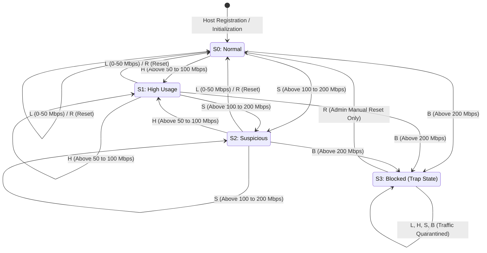

# State Transition Diagram
**Project:** Network Bandwidth Usage Anomaly Detection System  
**Module:** Formal Languages & Automata Theory (FLAT)  
**Document Name:** `State_Transition_Diagram.md`  

---

## 1. Visual State Transition Diagram

The following diagram models the Deterministic Finite Automaton (DFA) governing host bandwidth anomaly classification.

---

## 2. Diagram Component Definitions

### 2.1 States ($Q$)
- **`[*]` (Entry Point):** Represents initial host registration or onboarding into the network monitoring system. Leads directly into **S0**.
- **`S0` (Normal):** The default operational state. Host telemetry reflects safe, baseline network traffic ($0$–$50\text{ Mbps}$).
- **`S1` (High Usage):** Represents elevated bandwidth consumption ($51$–$100\text{ Mbps}$). The host is operating under high load (e.g., HD streaming or file transfers) without violating safety policies.
- **`S2` (Suspicious):** Represents threshold-exceeding bandwidth ($101$–$200\text{ Mbps}$). An anomaly warning is logged, and the host is highlighted on the administrative dashboard.
- **`S3` (Blocked):** An isolated quarantine state triggered by extreme bandwidth bursts ($>200\text{ Mbps}$). All further outbound/inbound transmission is blocked at the software or firewall layer.

### 2.2 Input Symbols ($\Sigma$)
- **`L` (Low / Normal):** $0 \le \text{Bandwidth} \le 50\text{ Mbps}$
- **`H` (High):** $50 < \text{Bandwidth} \le 100\text{ Mbps}$
- **`S` (Suspicious):** $100 < \text{Bandwidth} \le 200\text{ Mbps}$
- **`B` (Burst / Anomaly):** $\text{Bandwidth} > 200\text{ Mbps}$
- **`R` (Admin Reset):** Explicit manual intervention triggered by an authorized security analyst.

---

## 3. Explanation of State Transitions

### 3.1 Transitions from Non-Blocked States ($S_0, S_1, S_2$)
For all operational states prior to quarantine, the machine dynamically adapts based on instantaneous bandwidth readings:
1. **On input `L` ($0$–$50\text{ Mbps}$):**  
   Any active elevated usage has subsided. The host returns to (or remains in) **S0 (Normal)**.
2. **On input `H` ($51$–$100\text{ Mbps}$):**  
   The host transitions to (or remains in) **S1 (High Usage)**.
3. **On input `S` ($101$–$200\text{ Mbps}$):**  
   The host escalates to (or remains in) **S2 (Suspicious)**, prompting security alerts.
4. **On input `B` ($>200\text{ Mbps}$):**  
   The host immediately transitions to **S3 (Blocked)**. This is a severe threshold violation (e.g., volumetric DDoS burst, data exfiltration).
5. **On input `R` (Admin Reset):**  
   Forces the host to **S0 (Normal)** regardless of current non-blocked state.

### 3.2 Transitions from the Quarantined State ($S_3$)
State `S3` represents a critical security containment state:
1. **Self-Loop on Network Telemetry (`L, H, S, B`):**  
   Once quarantined, subsequent network readings (`L`, `H`, `S`, or `B`) **cannot** transition the host out of `S3`. The host loops indefinitely in `S3`:
   $$\delta(S_3, \text{telemetry}) = S_3$$
   This prevents automated attack cycling where malicious software lowers its transfer rate temporarily to escape quarantine.
2. **Escape via Administrator Reset (`R`):**  
   The **only** transition that exits `S3` is the manual administrator reset:
   $$\delta(S_3, R) = S_0$$
   This guarantees human-in-the-loop verification, requiring the administrator to inspect host logs, eliminate malware, or verify legitimate transfer requests before restoring network connectivity.

---

## 4. Alignment with the FSM Transition Table

This diagram is 100% compliant with the transition table established in [FSM_Design.md](file:///c:/Users/laksh/OneDrive/Desktop/Network-Bandwidth-Detection/FLAT/FSM_Design.md#4-state-transition-table):

| Current State | L (0–50 Mbps) | H (51–100 Mbps) | S (101–200 Mbps) | B (>200 Mbps) | R (Admin Reset) |
| :---: | :---: | :---: | :---: | :---: | :---: |
| **S0** | S0 | S1 | S2 | S3 | S0 |
| **S1** | S0 | S1 | S2 | S3 | S0 |
| **S2** | S0 | S1 | S2 | S3 | S0 |
| **S3** | **S3** | **S3** | **S3** | **S3** | **S0** |

Every arrow, state label, and input symbol directly mirrors the formal 5-tuple specification $M = (Q, \Sigma, \delta, q_0, F)$.
