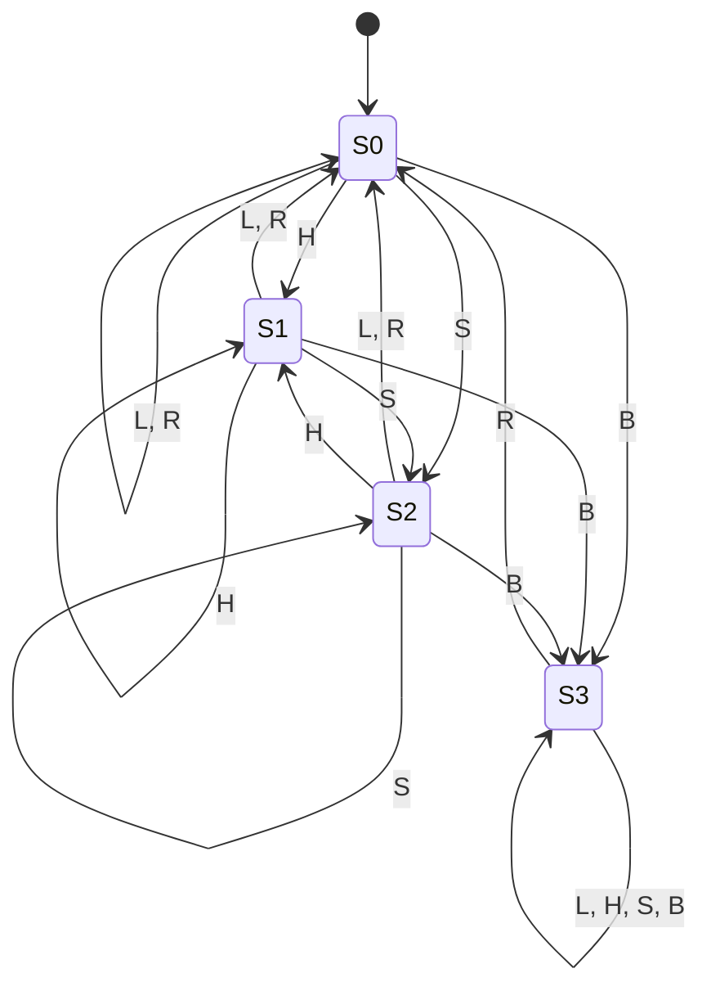

# Network Bandwidth Anomaly Detection System

## Finite State Machine (FSM) Design

### 1. Automata Definition

The Finite State Machine is designed to classify network bandwidth activity and identify abnormal usage conditions.

- **States (Q):** {S0, S1, S2, S3}
- **Input Alphabet (Σ):** {L, H, S, B, R}
- **Initial State (q0):** S0
- **Transition Function:** δ (Current State, Input)

### 2. FSM States

| State | Name | Description |
|---|---|---|
| S0 | Normal | Normal bandwidth activity |
| S1 | High Usage | Bandwidth is in the high range |
| S2 | Suspicious | Suspicious bandwidth activity detected |
| S3 | Blocked | Trap state — remains blocked until reset |

### 3. State Transition Diagram

### 4. State Transition Table

δ (Current State, Input Symbol) = Next State

| Current State | L | H | S | B | R |
|---|---|---|---|---|---|
| S0 | S0 | S1 | S2 | S3 | S0 |
| S1 | S0 | S1 | S2 | S3 | S0 |
| S2 | S0 | S1 | S2 | S3 | S0 |
| S3 | S3 | S3 | S3 | S3 | S0 |

### 5. Input Symbol Classification

| Symbol | Bandwidth Range / Meaning | Description |
|---|---|---|
| L | 0–50 Mbps | Low bandwidth |
| H | Above 50–100 Mbps | High bandwidth |
| S | Above 100–200 Mbps | Suspicious bandwidth |
| B | Above 200 Mbps | Burst / Anomaly bandwidth |
| R | Administrator control input | Manual FSM reset |

### 6. Trap State — S3

S3 is the trap state. When the machine enters S3, inputs L, H, S and B keep it in S3.

**S3 + L/H/S/B → S3**

The host remains blocked until an administrator performs a reset.

### 7. Administrator Reset — R

The administrator reset input R moves the FSM from any state to S0.

**R → S0**

Existing bandwidth history and alert records are preserved during reset.
